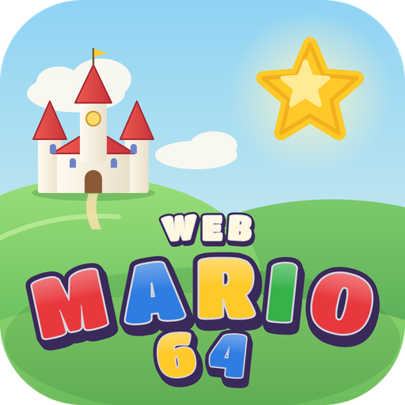
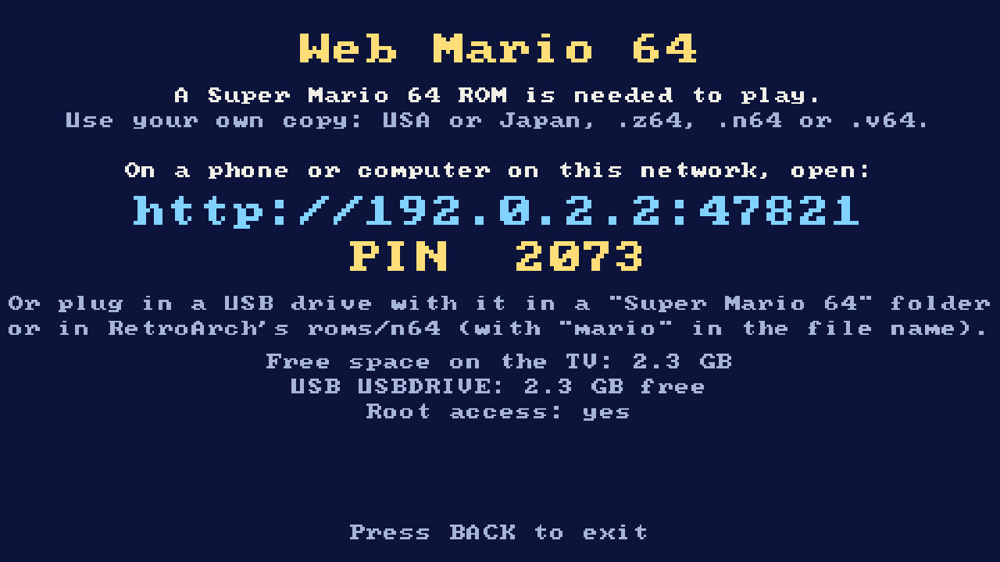
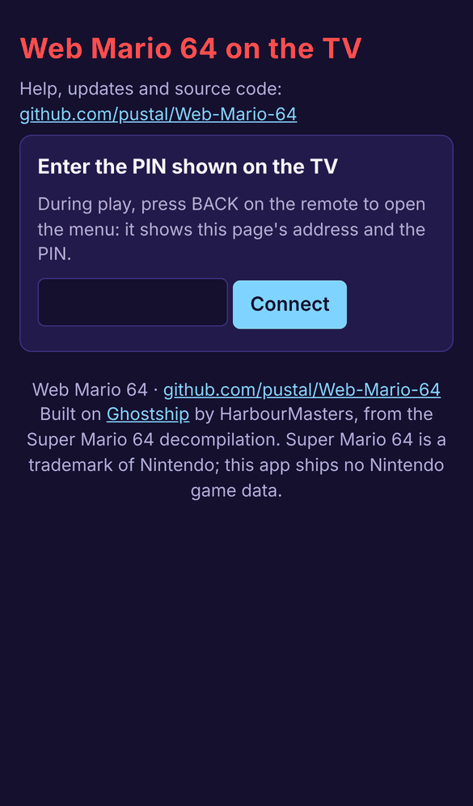
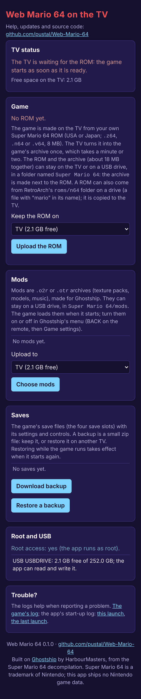

<p align="center"></p>

# Web Mario 64

**Version 1.1.0** · Super Mario 64 for LG webOS TVs, built from
[Ghostship](https://github.com/HarbourMasters/Ghostship), HarbourMasters' PC port of the Super Mario 64
decompilation, as a **native** app (SDL2, OpenGL ES 3), with a few TV-friendly extras:

- **Bring your own ROM, from your phone.** On first launch the TV shows an address and a PIN.
  Open it on any phone or computer on the same network and upload the Super Mario 64 ROM from your
  own copy of the game. The TV turns it into the game's asset archive (`sm64.o2r`) by itself, with
  Ghostship's own extractor: no PC step and no SSH.
- **Mods and saves** are managed on the same page: upload Ghostship mods (`.o2r`/`.otr` archives,
  such as texture packs), download a backup of your saves or restore one.
- **USB drives.** The game files (your ROM and the archive made from it, about 18 MB) can live on a USB
  drive instead of the TV: the archive is then made on the drive, and the page moves the files between
  the TV and a drive. Mods can live on a drive too, and a ROM can come from a RetroArch-style
  `roms/n64` folder. On rooted TVs, drives the app cannot reach on its own are used through root.
- **Plays with the remote.** Controllers work as usual; the remote is mapped too (below).
- **Back opens the menu** at any time, pausing the game: Resume, Game settings (Ghostship's own
  settings menu), Restart the game and Exit, with the transfer page's address and PIN, where the game
  data and the mods come from, the controls and the project page.

No game assets are included or downloaded by this project.

## Screenshots

These show the app's own screens; none of them contain game graphics.

| First launch on the TV | Transfer page: PIN | Transfer page |
|---|---|---|
|  |  |  |

## What you need

- An LG webOS TV with the [webOS Homebrew Channel](https://github.com/webosbrew/webos-homebrew-channel)
  (or Developer Mode).
- **A Super Mario 64 ROM**, USA or Japan, from a cartridge you own: an 8 MB `.z64`, `.n64` or `.v64` file
  with any name. The byte order does not matter, the app converts it. The app checks it against the
  supported dumps (SHA-1 `9bef1128717f958171a4afac3ed78ee2bb4e86ce` for the USA version,
  `8a20a5c83d6ceb0f0506cfc9fa20d8f438cafe51` for the Japanese one, both in `.z64` order).
- A controller is recommended; the remote works too.

## Install

Download the `.ipk` from the [releases](https://github.com/pustal/Web-Mario-64/releases) and install it
with the Homebrew Channel or `ares-install`. Start **Web Mario 64** on the TV.

## First start

The TV shows an address such as `http://192.168.1.20:47821` and a 4-digit PIN. Open the address on a
phone or computer on the same network, enter the PIN and upload the ROM. The TV then makes the game's
archive from it (a progress bar shows it; it takes a minute or two) and the game starts.

To keep the game files off the TV, choose a USB drive under **Keep the ROM on** before uploading: the ROM
goes into the drive's **`Super Mario 64`** folder and the archive is made next to it. Or put the ROM in
that folder yourself and plug the drive in: the setup screen finds it and makes the archive there. A
drive set up for RetroArch works as it is: a Super Mario 64 ROM in its `roms/n64` or `roms/nintendo64`
folder (see [USB drives](#usb-drives)) is copied to the TV.

The ROM is kept next to the archive, so the archive can be made again later, for example after an
update of the app (**Make the archive again** on the page). **Move the game files to** moves both
between the TV and a drive at any time, even while the game runs (the next start uses the new place).

## Remote control

| Button | Game |
|---|---|
| Arrow keys | Control stick |
| OK or Green | A (jump) |
| Red | B (punch) |
| Yellow | Z (crouch, ground pound) |
| Blue | R (camera mode) |
| 2 / 8 / 4 / 6 | C up / down / left / right (camera) |
| 0 or Play | Start (pause) |
| Back (or Exit) | The menu |

On a controller, the Guide button, or Back and Start together, open the menu. In the menu, move with the
arrows (or 2/8), choose with OK, 0 or A, and resume with Back or B. **Game settings** opens Ghostship's
own menu (graphics, audio, controls and its enhancements). Move through it with the arrows: they pick a
panel, OK enters it, and inside the arrows move between settings and OK changes one (a controller works
the same way, with B to leave a panel). Back closes it. While it is open the remote keys are not remapped. The mapping lives in
`src/port/RemoteInput.cpp` (`kMappings`); the game's own controls (Game settings, Controller) still apply
on top.

## Transfer page

The page (port 47821, or the next free one) answers only devices on your local network, and only with the
PIN shown on the TV. It shows:

- **Game**: where the ROM and the archive are, upload the ROM to the TV or a USB drive (or remove it),
  move the game files between the TV and a drive, the progress while the archive is made, and
  **Make the archive again**.
- **Mods**: upload `.o2r`/`.otr` mods to the TV or a USB drive, move or remove them. Ghostship loads them
  at start-up; turn them on and off in its menu (Game settings, Mods).
- **Saves**: the save files, **Download backup** (a small zip file with the saves and the settings) and
  **Restore a backup**.
- **Root and USB**: root access and each drive's space and contents.
- **Trouble?**: the game's and the port's logs, for reporting problems.

A ROM, mod or save backup received while the game runs is used when it starts again: the page then offers
**Restart the game now** (the menu has the same).

## USB drives

A drive keeps the game's files in its `Super Mario 64` folder:

```
Super Mario 64/<rom>.z64, .n64 or .v64     the ROM (any name; the app names the ones it puts there baserom.z64)
Super Mario 64/sm64.o2r                    the game's archive, made from that ROM
Super Mario 64/mods/                       mods (.o2r/.otr archives or folders)
```

**Game files on a drive.** A ROM in a drive's `Super Mario 64` folder is used where it is, and the archive
is made next to it (written there directly, or made on the TV and moved there by root when the app cannot
write to the drive). At start-up the app links a drive's archive where the game reads it; the TV's own
archive, if there is one, is used first. Without the drive the game cannot start: the TV waits on the setup
screen until the drive is back.

**RetroArch folders.** When there is no ROM on the TV or in a drive's `Super Mario 64` folder, the app also looks
in the RetroArch-style `roms/n64` and `roms/nintendo64` folders at the root of each drive (any
capitalisation, and up to two folder levels below them) for `.z64`, `.n64` and `.v64` files with "mario"
in their name (any capitalisation). An 8 MB file that is a supported ROM is checked and **copied** to the
TV, so the game keeps working without the drive. Nothing in the RetroArch folders is changed. The page and
the menu show where the copy came from.

At start-up, a drive's mods are linked where the game looks (`mods/usb-<drive>/`, next to the TV's).
Whether the app can read and write a drive itself depends on the TV's firmware; on a rooted TV (the app
runs as root, or the Homebrew Channel runs root commands for it), drives it cannot reach on its own are
used through root. Saves always stay on the TV.

## Where things are kept

Everything is in the app's own storage (`$HOME/data`), which webOS removes with the app:

```
ship/              Ghostship's folder: sm64.o2r (the archive, or a link to a drive's), mods/, saves/,
                   ghostship.cfg.json, logs/
rom/baserom.z64    your ROM, in .z64 byte order (when the game files are on the TV)
transfer_pin.txt   the transfer page's PIN (delete it for a new one)
port-log.txt       the port's log (port-log-previous.txt: the launch before)
```

## Building

The toolchain is Linux x86_64 only (on macOS, build inside a Linux VM or container).

```sh
git clone https://github.com/pustal/Web-Mario-64.git
cd Web-Mario-64
export WEBOS_SDK=$HOME/arm-webos-linux-gnueabi_sdk-buildroot   # webosbrew toolchain, relocated
npm install -g @webos-tools/cli                                # ares-package
scripts/build-webos.sh
```

The result is `dist/org.webmario64.app_<version>_arm.ipk`, with `dist/org.webmario64.app.manifest.json`
for the Homebrew Channel. No ROM is needed to build.

Without the webOS toolchain, `cmake -B build -G Ninja && cmake --build build` builds the same app for
desktop Linux (system SDL2 and OpenGL), which runs from `build/ghostship`: handy for working on the
transfer page, the setup screen and the menu. `WM64_DATA_DIR` sets its data folder and `WM64_USB_ROOT` a
folder whose subfolders stand in for USB drives.

The logo and the icons come from `scripts/make-logo.py` (an SVG drawn in code, rendered with Chromium
through Python Playwright): `python3 scripts/make-logo.py <titan-one.woff2>`, with the Titan One font
(for example from `npm pack @fontsource/titan-one`).

How it fits together:

- `cmake/FetchGhostship.cmake` downloads Ghostship at a pinned commit (with libultraship and Torch);
  `cmake/PatchUpstream.cmake` copies it into the build folder and applies `patches/` there. The patches
  only hook the build: Ghostship's sources are unchanged.
- The patched Ghostship is built as its own CMake project. `cmake/GhostshipWebOS.cmake` supplies
  SDL-webOS, OpenGL ES 3 (a link stub, as the toolchain's sysroot stops at ES 2; the TV has ES 3), the
  libraries the TV lacks, and the port layer in `src/`; Ghostship's `main()` becomes `ghostship_main()`.
  Scripting (TinyCC), native mod libraries and online features are left out.
- `src/main.cpp` prepares the data folder, USB drives, the transfer page and the setup screen, then runs
  the game. `src/port/Extractor.cpp` makes `sm64.o2r` in a child process, with Ghostship's extractor and
  the `config.yml` and `assets/` descriptions shipped in the app.
- `src/port/SdlHooks.cpp` sees the game's SDL calls first (linker `--wrap`): the remote mapping, the menu
  (drawn inside the game's buffer swap, which pauses the game) and fullscreen.

## Credits and legal

Ghostship is made by HarbourMasters and contributors and published under the MIT licence, on
libultraship and Torch (also MIT); it builds on the [Super Mario 64 decompilation](https://github.com/n64decomp/sm64)
project. This port is published under the GNU GPL v3 (`LICENSE`) and is not made or endorsed by them. See
`THIRD_PARTY_NOTICES.md` for the libraries it uses.

Super Mario 64, Mario and their characters, names, music and art are Nintendo's. This project contains
and downloads no Nintendo game data: you supply your own ROM. It is not affiliated with or endorsed by
Nintendo.
